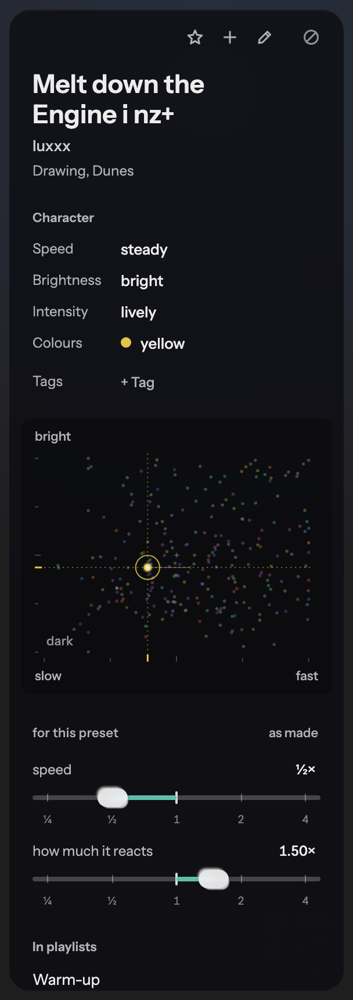
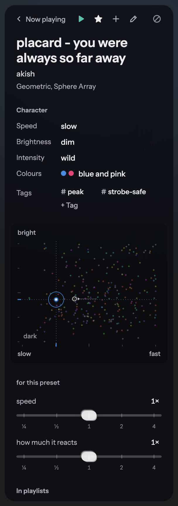
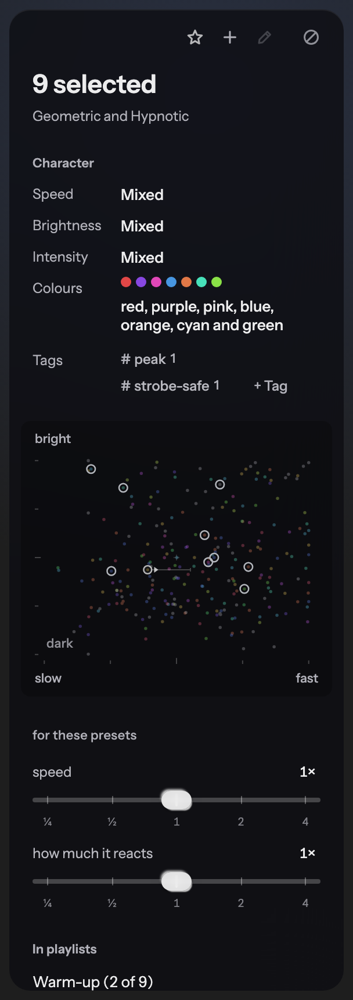
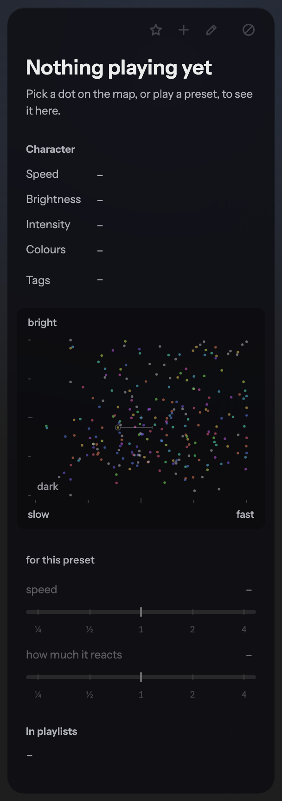
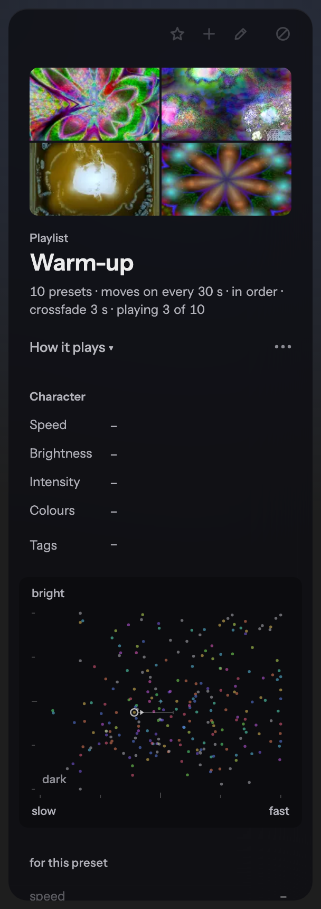
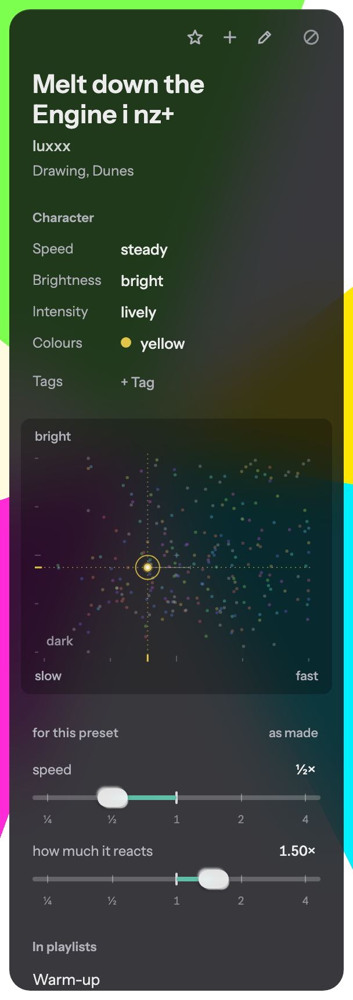
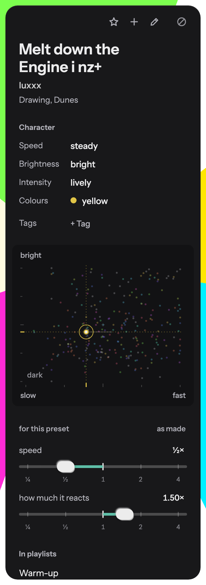

# The inspector

Home's inspector (`app/src/ui/Inspector/`) redesigned from three case studies of
inspector panels, adapted to visual[flow]'s direction: an instrument, sleek and warm,
few lines, the presets the hero, controls that feel like pro audio gear.

Ryan's standing decisions held throughout: title and artist on top, no "Now playing"
line, the actions in the header, the preset map first under the metadata, liquid-glass
sliders, and hovering a library tile animates the tile, never the inspector.

| | |
| --- | --- |
|  |  |
| The preset playing (its tune kept at ½× speed, 1.50× reacting) | One picked: back, Play (the one tinted glyph) |
|  |  |
| Several picked: every pick ringed on the map, "Mixed" where they differ | Nothing playing: the same skeleton, actions off, dashes, the map unmarked |
|  |  |
| The playlist card in the identity slot, the skeleton under it | Over a bright, saturated preset |
|  | |
| Reduce transparency: an opaque panel, an opaque knob | |

The pictures are the `Layout/Inspector` stories (`app/src/ui/Inspector/Inspector.stories.tsx`),
captured headless at 2×.

## The case studies

### Figma's properties panel (UI3)

Sources: figma.com/blog/behind-our-redesign-ui3, figma.com/blog/our-approach-to-designing-ui3,
help.figma.com (360039832014, 15023124644247, 360041064814), 925studios.co's design
breakdown, and Figma forum threads #8217, #3058, #16924, #20267, #41667, #58377.

- Identity first (the selection's name and type, its actions beside it), then the controls
  touched most. UI3 kept x/y above w/h because moving them broke muscle memory.
- Its most-cited failure was sections that moved between object types, and an action set
  users called "almost random" because it changed between near-identical selections.
- Values must be in plain view: UI3 put a checkbox back and inlined blend mode, because
  people had to wait for a tooltip to read the value.
- Hierarchy by weight and contrast at ~11 px; users found the small grey type hard to read,
  and the minimal-label version was dropped for accessibility.
- Several selected: differing values read "Mixed" and still take input. Nothing selected
  still shows something useful.

### macOS inspectors, HIG to Liquid Glass

Sources: Apple HIG (Panels, Split views, Windows, Layout, Materials, Color, Sliders,
Sidebars), AppKit `NSSplitViewItem(inspectorWithViewController:)`, SwiftUI
`inspectorColumnWidth`, "Adopting Liquid Glass", WWDC25 sessions 310 and 356, the Photos
and Keynote user guides, Apple forums thread 821546, and reviews by MacMost, MacStories,
Six Colors, NN/g (via anderegg.ca), mjtsai, 9to5Mac, TidBITS, Eclectic Light and MacRumors.

- An inspector sits on the trailing side and follows the selection; identity, then
  description, then controls (Photos' Info: title, caption, keywords, a map with a pin).
- Glass is for the functional layer only, never content; sliders and toggles turn to glass
  while dragged. Tint only the primary action. Hierarchy by layout and grouping, not
  separators. Corners are concentric.
- Sliders get a neutral value (Apple's example is playback speed anchored at 1×), so the
  fill shows the difference from normal.
- Liquid Glass launched "almost offensively illegible"; the fixes were more frosting, then
  more opacity in macOS 27. Reduce Transparency and Increase Contrast are the real fixes.
- Keep the bottom edge clear of controls.

### Performance tools: Resolume Arena, Ableton Live, VDMX

Sources: resolume.com/support (clips, dashboard, layers, parameters, parameter-animation,
bpm, midi-shortcuts) and Resolume forum threads (p=88365, 38578, 57352, 17236, 68379,
89651, 94683, 89863, 46533, 32894, 80058); the Live 12 manual (clip view, browser,
shortcuts), help.ableton.com and Ableton forum threads (p=1740141, 1716602); VDMX's slider
tutorial; interactiveimmersive.io on TouchDesigner; cdm.link and dj.studio.

- Resolume repeats one panel layout at clip, layer and composition level.
- Speed is musical: /2 and ×2, powers of two. A parameter resets in one gesture; you click
  its number to type a value.
- The dangerous actions sit apart; "Lock Content" keeps the playing clip from being
  replaced while its parameters stay live. Blanking the output by accident is "a real
  showkiller".
- Tiny, thin type is the top complaint in both Resolume and Live.

## The principles, and how each shows up

1. **Identity first.** The title leads in the large humane sans (`.insp-name`, never on
   glass), the artist under it, the style a quiet subtitle (`.insp-id`).
2. **One fixed skeleton.** `.insp[data-state]` has the same children in every state:
   header → identity → character → map → tune → playlists. Nothing playing and the
   playlist card keep every section, with dashes, a disabled tune and an unmarked map.
3. **Actions in one stable glyph group in the header.** Play (one picked only, the one
   tinted glyph), Star, Add, Edit (lab builds), then Never set apart and quieter. With
   nothing to act on they stay in place, disabled. Never goes on at once and is undone
   from a toast under the header ("Won't play it on its own · Undo"), not a confirm.
4. **Current state in plain view.** The star fills; Never on is tinted and says "Never"
   beside its glyph; each slider's value is always shown ("½×").
5. **Space and tone, not lines.** Small captions ("Character", "for this preset", "In
   playlists") and one section gap; no hairlines in the panel. More than four playlists go
   behind a quiet "+n more".
6. **Read-only reads as text.** Speed, brightness, intensity and colours are caption-then-
   value rows in one grid, values at full contrast and weight; my tags close the rows.
7. **The map is the one picture.** A flat plate with concentric corners (the panel's radius
   less its inset); its axis words (slow, fast, dark, bright) are the rows' words. The
   subject is lit; several picked are each ringed; nothing playing leaves it unmarked with
   a prompt.
8. **Glass only on the functional layer.** The knob is the liquid-glass capsule; the rail
   is quiet and grows the knob a little while held.
9. **Fill from 1×.** The fill runs from the 1× tick to the value, either way.
10. **Musical multiples.** A log rail ¼×–4× with detents at ¼ ½ 1 2 4 (a drag catches
    within a sixth of a doubling), fraction labels under it, arrows stepping between
    detents (Shift nudges a twelfth), Home/End to the ends, double-click or Delete back to
    1×, and the readout a button that turns into a field ("0.5", "1/2", "½", "2x").
11. **Mixed.** Several picked whose values differ read "Mixed" with no knob or fill; any
    move sets all of them. "as made" clears the tune on all of them.
12. **Assume the worst background.** The panel paints a dense dark tint
    (`--insp-tint`, rgba(14 14 18 / 0.82)) over a 30 px blur, so white strobes behind it
    still read as a dark panel. `prefers-reduced-transparency` and `prefers-contrast: more`
    make it opaque (and the knob opaque); more contrast also lifts the captions to full ink.
13. **Keep the bottom edge clear.** The actions and the toast are at the top; the bottom
    holds only the playlists, which scroll.
14. **Never replaces the playing preset by accident.** Only Play plays; the map's dots and
    the tune only show and tune.

## Where it deviates, and why

- **Play appears and disappears.** Principle 3 says an action that doesn't apply is
  disabled, not removed; Ryan's standing decision is Play only when the preset isn't
  playing, and a disabled Play beside the playing preset would read as broken.
- **Edit is disabled for several picked** rather than hidden as before (principle 3).
- **Numbers are in Instrument Sans's tabular figures, not a monospace.** The app dropped
  the monospace for numbers (`app.css`); tabular figures keep columns steady and stay in
  the humane voice. Off the detents the readout keeps two decimals ("1.50×") so it doesn't
  change width as it moves.
- **"Mixed" is said, not left blank** (Apple leaves mixed values blank): a blank slider
  reads as broken, and Figma's "Mixed" is clearer.
- **The tune's caption stays "for this preset"** (`words.ts`), not "Tune": it's Ryan's word.
- **The several-picked pictures are gone**: the marked map replaces them, and a second
  picture would compete with the grid's tiles (also why Resolume's "picture is the handle"
  wasn't taken).
- **Dashes are quiet**, in the caption colour, so a column of them in the empty states
  holds the rows' places without shouting.
- **Escape dismisses the toast first** wherever focus is; the next Escape closes the panel.
- **Reduced transparency in stories** is asked for with `data-transparency="reduced"` on
  the layout, since a page can't switch the system setting.

## Not taken

- A big picture in the inspector: Home's hero and tiles are already the picture and the trigger.
- Never in a "More" menu: there are only four actions, and Ryan wants them in the header.
- Figma's labels toggle and scrubbable labels: too much tool for four values; typing into
  the readout covers the precise case.
